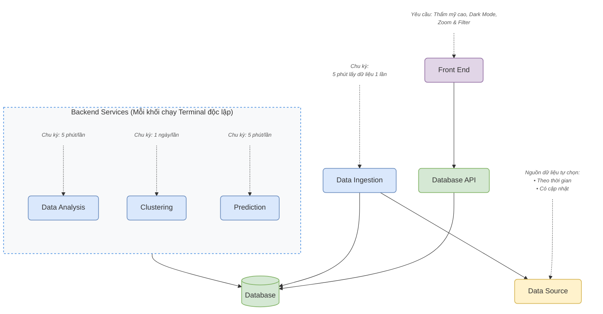
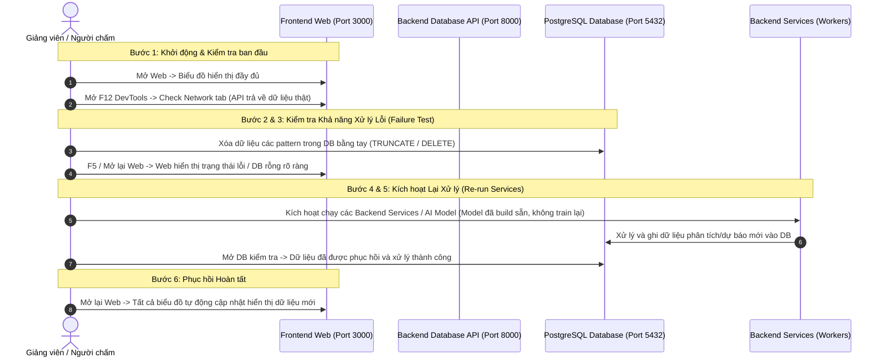

# 📋 YÊU CẦU BẮT BUỘC ĐỒ ÁN CUỐI KỲ (TIME-SERIES & HỆ THỐNG GDMAS)

> 👨‍🏫 **Giảng viên hướng dẫn:** TS. Phạm Tuấn (`ptuan@ute.udn.vn`)  
> 💡 **Quy tắc triển khai cốt lõi:**  
> Mỗi khối trong kiến trúc hệ thống phải được chạy ở một terminal riêng biệt như một **service độc lập** (mô hình Microservices/Modular). Hệ thống có thể chạy toàn bộ tự động qua Docker Compose.

---

## 1. 🏗️ Sơ đồ Kiến trúc Hệ thống

### 1.1. Sơ đồ trực quan (Mermaid Diagram)



---

### 1.2. Sơ đồ dạng Text (ASCII)

```text
                                [ Thẩm mỹ cao, Zoom & Filter ]
                                               │
                                               ▼
                                        ┌──────────────┐
                                        │  Front End   │
                                        └──────┬───────┘
                                               │
                                               ▼
                                        ┌──────────────┐
                                        │ Database API │
                                        └──────┬───────┘
                                               │
                                               ▼
┌──────────────┐     ┌──────────────┐     ┌──────────────┐     ┌────────────────────────────────────────────────┐
│ Data Source  │ ◄── │Data Ingestion│ ──► │   Database   │ ◄── │                Backend Services                │
└──────▲───────┘     └──────▲───────┘     └──────────────┘     │ ┌─────────────┐ ┌────────────┐ ┌─────────────┐ │
       │                    │                                  │ │Data Analysis│ │ Clustering │ │ Prediction  │ │
[Nguồn dữ liệu:      [Tần suất:                                │ └──────▲──────┘ └─────▲──────┘ └──────▲──────┘ │
 - Theo thời gian     5 phút lấy                               └────────┼──────────────┼───────────────┼────────┘
 - Có cập nhật]       dữ liệu 1 lần]                                    │              │               │
                                                                   [Tần suất:     [Tần suất:      [Tần suất:
                                                                    5 phút/lần]    1 ngày/lần]     5 phút/lần]
```

---

## 2. 📈 Các Patterns Phân Tích Bắt Buộc (Time-Series Data)

> ⚠️ **Điều kiện tiên quyết:** Toàn bộ dữ liệu hiển thị trên các biểu đồ **bắt buộc phải qua xử lý và load từ API Backend**, không hardcode dữ liệu tĩnh tại Frontend.

|  STT  | Nhóm Phân Tích                 | Chi Tiết Biểu Đồ & Yêu Cầu                                                                                                                                       |          Tần Suất / Phạm Vi           |
| :---: | :----------------------------- | :--------------------------------------------------------------------------------------------------------------------------------------------------------------- | :-----------------------------------: |
| **1** | **Biểu diễn theo thời gian**   | Vẽ **3 biểu đồ** tương ứng với các quãng thời gian:<br>• `Line chart` (Đường xu hướng)<br>• `Scatter plot` (Phân tán điểm)<br>• `Histogram` (Phân phối tần suất) |          Ngày / Tuần / Tháng          |
| **2** | **Trend Analysis**             | Biểu diễn xu hướng (Trend) của dữ liệu sau khi thực hiện **Re-sampling**                                                                                         | Tháng _(hoặc Tuần nếu thiếu dữ liệu)_ |
| **3** | **Seasonality**                | Biểu diễn tính chu kỳ / mùa vụ (**Seasonal line**) sau khi **Re-sampling**                                                                                       | Tháng _(hoặc Tuần nếu thiếu dữ liệu)_ |
| **4** | **Tương quan (Correlation)**   | Ma trận tương quan (Correlation Matrix / Heatmap) giữa các biến đo đạc                                                                                           |                Đa biến                |
| **5** | **Hồi quy & Dự báo**           | Hiển thị giá trị dự báo định lượng cho ngày tiếp theo _(Ví dụ: Số lượng sự kiện địa chấn, nhiệt độ, phụ tải điện)_                                              |        Ngày kế tiếp ($t + 1$)         |
| **6** | **Phân loại (Classification)** | Hiển thị nhãn phân loại dự đoán cho ngày tiếp theo _(Ví dụ: Nguy cơ rủi ro cao/thấp, thời tiết nắng/mưa)_                                                       |        Ngày kế tiếp ($t + 1$)         |

---

## 3. 🎯 Tiêu Chuẩn Sản Phẩm Mong Muốn (Deliverables)

### 🖥️ 3.1. Giao diện Người dùng (Frontend)
- [ ] **Độ bao phủ dữ liệu:** Hiển thị trực quan đầy đủ (hoặc mở rộng hơn) toàn bộ 6 patterns đã nêu ở mục 2.
- [ ] **Tính thẩm mỹ cao:** Thiết kế hiện đại, chuyên nghiệp, hỗ trợ Dark Mode, bố cục trực quan.
- [ ] **Khả năng tương tác (Điểm cộng):** Biểu đồ có khả năng Zoom (phóng to/thu nhỏ) và Filter (lọc theo khoảng thời gian, độ lớn, độ sâu).

### ⚙️ 3.2. Kiến trúc & Vận hành Hệ thống
- [ ] **Hoạt động đúng chức năng:** Hệ thống chạy trơn tru, không gặp lỗi ngắt quãng chuỗi pipeline.
- [ ] **Kiến trúc module / Microservices:** Tách bạch rõ rệt từng service chạy độc lập (Ingestion, Database, Database API, Data Analysis, Clustering, Prediction, Frontend).
- [ ] **Cập nhật theo thời gian:** Dữ liệu tự động cào và cập nhật kết quả phân tích theo chu kỳ (5 phút / 1 ngày).

### 📑 3.3. Báo cáo & Tài liệu kỹ thuật
- [ ] Báo cáo sạch đẹp, rõ ràng, đầy đủ thông tin cấu hình, giải thuật và sơ đồ.
- [ ] Đóng tập nộp kèm Source code hoàn chỉnh.

### 🗣️ 3.4. Năng lực Phản biện & Hiểu sâu Hệ thống
- [ ] Nắm vững nguyên lý hoạt động của từng service và luồng dữ liệu truyền tải giữa các khối.
- [ ] Trả lời phản biện rõ ràng, tự tin các câu hỏi vấn đáp kỹ thuật từ hội đồng/giảng viên.

---

## 4. 🎬 Kịch Bản Các Bước Thực Hiện Trong Buổi Demo (Bắt buộc)

Hội đồng và giảng viên sẽ kiểm tra trực tiếp theo đúng 6 bước thực nghiệm sau:



### Các bước cụ thể khi thực hiện Demo:
1. **Khởi động & Check API:** 
   - Show hình / xóa sạch container cũ.
   - Chạy lệnh `docker compose up` để khởi động toàn bộ hệ sinh thái.
   - Mở giao diện Web -> hiển thị đầy đủ các biểu đồ patterns.
   - Mở cửa sổ DevTools (`F12`), kiểm tra tab **Network** để chứng minh dữ liệu được gọi và nạp trực tiếp từ Backend API (không dùng mock tĩnh).
2. **Xóa dữ liệu DB thủ công (Manual Invalidation):**
   - Truy cập vào PostgreSQL Database, thực hiện xóa dữ liệu các bảng kết quả pattern bằng tay (`DELETE` / `TRUNCATE`).
3. **Kiểm tra trạng thái lỗi trên Web:**
   - Mở lại trang Web -> Giao diện phản hồi chính xác trạng thái lỗi, bảng dữ liệu trống hoặc có thông báo lỗi kết nối/thiếu dữ liệu (chứng minh Web phụ thuộc 100% vào DB).
4. **Kích hoạt các Backend Services:**
   - Mở các API / kịch bản runner của các Backend services (Data Ingestion, Analysis, Prediction, Clustering) và kích hoạt chạy.
   - Lưu ý: Các mô hình AI/ML đã được huấn luyện sẵn (pre-trained model), chỉ tải lên và inference, **không train lại từ đầu trong buổi demo**.
5. **Kiểm tra dữ liệu DB được hồi phục:**
   - Mở lại Database để thấy dữ liệu đã được các workers xử lý, tính toán và nạp lại vào bảng thành công.
6. **Kiểm tra Web phục hồi:**
   - Mở lại Web -> Toàn bộ các biểu đồ và số liệu phân tích lập tức xuất hiện trở lại chuẩn xác.

---

## 5. 📊 Cơ Cấu Thang Điểm & Tiêu Chí Đánh Giá

### 5.1. Thang điểm chuẩn (10 điểm)

| Tiêu Chí Đánh Giá | Điểm Số | Yêu Cầu Cụ Thể |
| :--- | :---: | :--- |
| **Kiến trúc hệ thống chuẩn** | **3.0 điểm** | Thiết kế đầy đủ các khối chức năng và phân tách service độc lập đúng theo sơ đồ kiến trúc (Front End, Database API, Database, Data Ingestion, Data Analysis, Clustering, Prediction). |
| **Độ bao phủ các Patterns** | **3.0 điểm** | Đầy đủ 6 patterns phân tích bắt buộc với **điều kiện tiên quyết phải có xử lý thuật toán và nạp dữ liệu động từ API**. |
| **Giao diện Web (UI)** | **1.0 điểm** | Giao diện đẹp mắt, thẩm mỹ cao, bố cục khoa học, có Dark Mode, hiển thị trực quan. |
| **Container hóa (Docker)** | **1.0 điểm** | Đóng gói toàn bộ hệ thống bằng Docker và khởi chạy đồng bộ thông qua `docker-compose.yml`. |
| **Slide trình bày** | **1.0 điểm** | Slide súc tích, mạch lạc, sơ đồ rõ ràng, thể hiện rõ hiểu biết sâu về hệ thống. |
| **Cấu trúc Source Code** | **1.0 điểm** | Tổ chức mã nguồn chuẩn mực, phân tầng rõ ràng (Clean Architecture), tuân thủ quy ước đặt tên và cấu trúc thư mục. |
| **TỔNG CỘNG** | **10.0 điểm** | **Đạt chuẩn tối đa đồ án cuối kỳ** |

### 5.2. Các tiêu chí Điểm cộng (Bonus tối đa +2.0 điểm)

Hệ thống có cơ hội nhận thêm **điểm cộng (lên đến 2 điểm)** nếu hoàn thiện các tính năng nâng cao sau:
- [x] **Docker hóa toàn diện:** Toàn bộ 7 dịch vụ độc lập chạy trong môi trường container khép kín.
- [x] **Tổ chức code xuất sắc:** Tách biệt rõ modular services, clean code, có script tự động hóa quản lý (`dev.ps1`).
- [ ] **Deploy lên Cloud:** Triển khai hoạt động trực tuyến trên hạ tầng đám mây:
  - *Phương án AWS:* EC2 + Lambda + PostgreSQL (RDS).
  - *Phương án Azure:* VM + Function + Container Apps + Azure PostgreSQL.
- [x] **Biểu đồ tương tác cao (Interactive Charts):** Tích hợp khả năng **Zoom** (phóng to/thu nhỏ dải thời gian) và **Filter** (lọc động theo độ lớn, độ sâu, khu vực địa chấn).

---

## 6. 📑 Quy Chuẩn Nội Dung Báo Cáo In Nộp

Tập tài liệu báo cáo in nộp bắt buộc phải có đầy đủ các chương mục kỹ thuật sau:

1. **Giao diện chương trình:**
   - Chụp ảnh màn hình toàn bộ các view giao diện chính: Tổng quan Dashboard, Bản đồ giám sát Live, Danh mục động đất, 6 Patterns phân tích, Báo cáo & Cấu hình.
2. **Sơ đồ khối chức năng:**
   - Sơ đồ kiến trúc tổng thể.
   - Miêu tả chi tiết chức năng, vai trò và luồng giao tiếp của từng khối (Ingestion, DB, API, Analysis, Clustering, Prediction, Web).
3. **Sơ đồ mạng (Network Diagram):**
   - Sơ đồ kết nối mạng giữa các container trong Docker bridge network (`gdmas-net`), các port publish ra máy host (3000, 8000, 5432).
4. **Bảng thông tin cấu hình hệ thống (System Configuration):**
   - **Tần suất cập nhật:** Chu kỳ quét Ingestion (5 phút), Analysis (5 phút), Prediction (5 phút), Clustering (1 ngày).
   - **Thời gian training model:** Thời lượng huấn luyện của mô hình hồi quy / phân loại.
   - **Khung thời gian dữ liệu (Data Window):** Khoảng thời gian lịch sử cần thiết để đưa ra dự báo $t+1$ (ví dụ: chuỗi 30 ngày / 90 ngày gần nhất).
   - **Dung lượng dữ liệu train:** Số lượng mẫu/sự kiện đã sử dụng để huấn luyện mô hình.
   - **Chu kỳ Re-training:** Quy định khi nào mô hình AI được bắt đầu huấn luyện lại (định kỳ tuần/tháng hoặc khi có data drift).
5. **Mô tả chi tiết các thuật toán sử dụng trong hệ thống:**
   - **Thuật toán Gom cụm (Clustering):** Mô tả thuật toán DBSCAN (phát hiện chùm động đất theo bán kính $\epsilon$ và số điểm lân cận `min_samples`) hoặc KMeans.
   - **Thuật toán Dự báo (Prediction):** Mô tả thuật toán dự báo số lượng sự kiện ngày kế tiếp (ARIMA / SARIMA / Ridge Regression / Linear Regression).
   - **Thuật toán Phân loại (Classification):** Mô tả thuật toán phân loại mức độ rủi ro địa chấn ngày kế tiếp (Random Forest / Logistic Regression / Decision Tree).
6. **Mã nguồn in kèm (Source Code Appendix):**
   - Đóng kèm toàn bộ mã nguồn cốt lõi của các khối dịch vụ.

---

## 7. 🗂️ Phụ Lục Tham Chiếu: Đối Sánh Patterns Dữ Liệu

Giảng viên đưa ra 2 hướng đề tài để sinh viên lựa chọn. Dự án GDMAS thực hiện theo **Đề tài Dữ liệu Chuỗi Thời Gian (Time-Series Data)**. Bảng dưới đây giúp đối sánh quy đổi yêu cầu:

| STT | Time-Series Data *(Dự án GDMAS lựa chọn)* | Text Data *(Đề tài tham khảo khác)* |
| :---: | :--- | :--- |
| **1** | 3 biểu đồ theo thời gian (Line, Scatter, Histogram) | Số bảng tin theo thời gian (tổng và theo category) |
| **2** | Trend Analysis sau Re-sampling Tháng/Tuần | Trích xuất từ khóa quan trọng và vẽ số lượt nhắc đến gần đây |
| **3** | Seasonal line sau Re-sampling Tháng/Tuần | Số lượt xem / reaction theo thời gian của các từ khóa quan trọng |
| **4** | Correlation Matrix đa biến định lượng | Tương quan đa biến (lượt xem, từ khóa, mức lương, kinh nghiệm...) |
| **5** | Dự báo định lượng giá trị ngày mai ($t+1$) | Dự đoán/Clustering nhóm tin tức hoặc phân cụm công ty tuyển dụng |
| **6** | Phân loại nhãn ngày mai ($t+1$) | Phân loại bảng tin tiêu cực/tích cực (thang đo 1 đến 5) |

---
*Tài liệu này là Hiến chương Yêu cầu Bắt buộc cho Đồ án Cuối kỳ GDMAS, được đối chiếu và cập nhật chuẩn xác theo tài liệu chỉ đạo của TS. Phạm Tuấn.*
